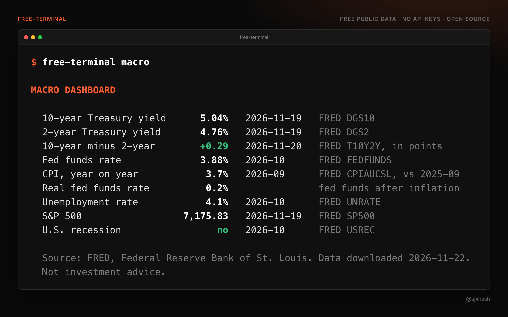
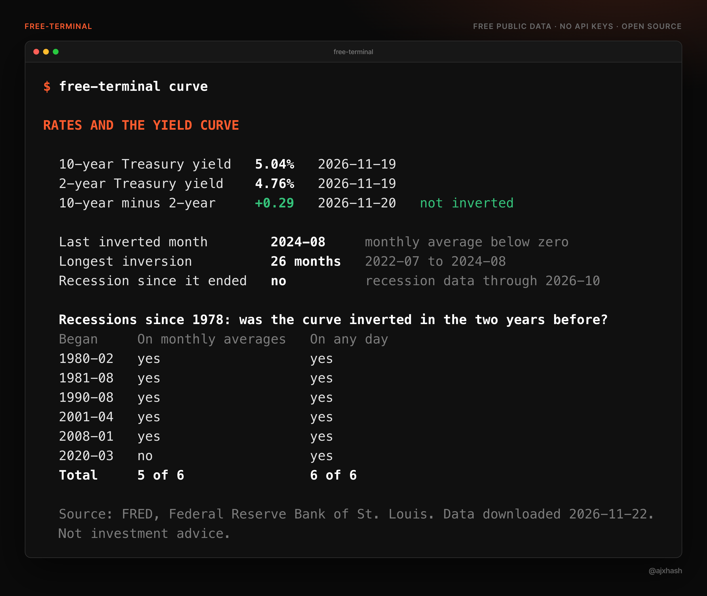
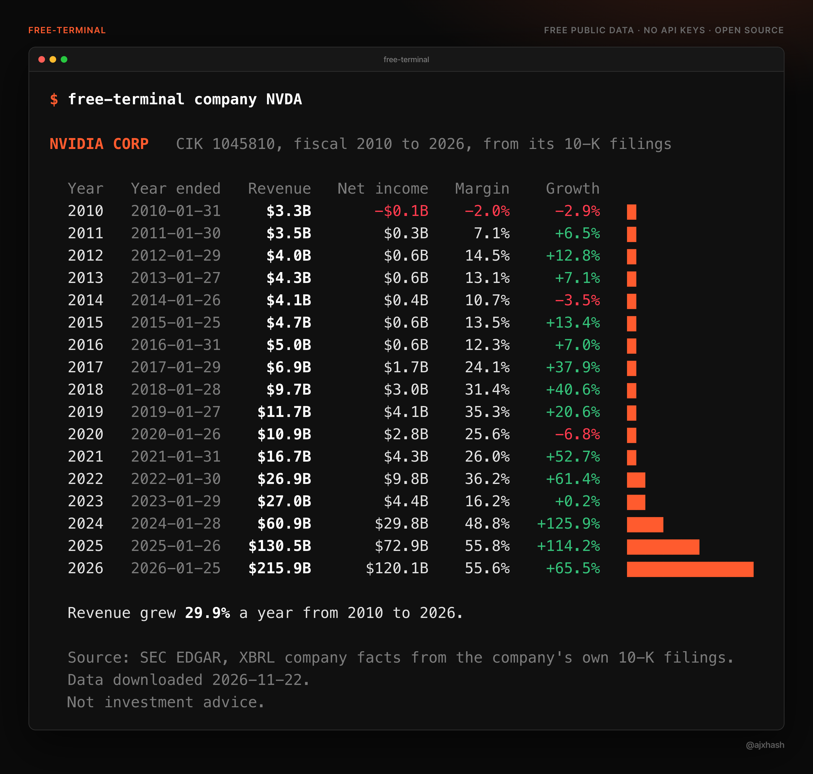
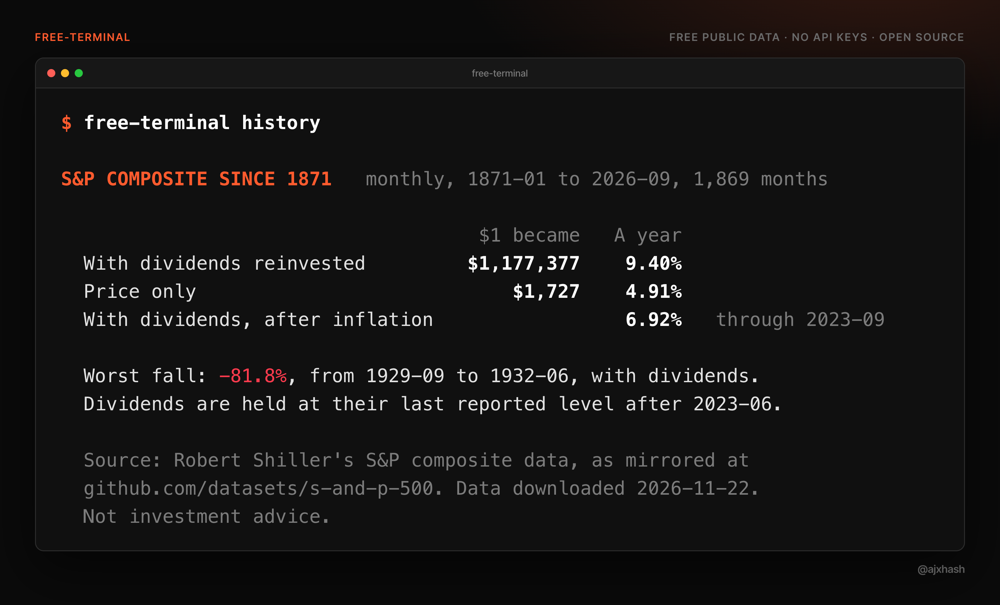
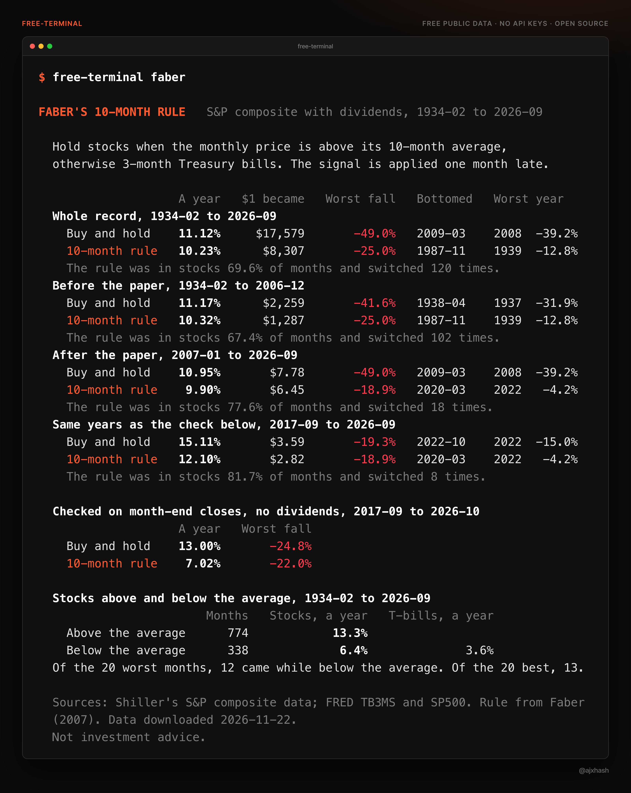

# free-terminal

**Five market-terminal functions in your terminal, on free public data.**

A macro dashboard, the yield curve, company fundamentals, the S&P since 1871 and
a test of a published trading rule. No API keys, no account, no paid feed, no
npm packages. Every number comes from FRED, SEC EDGAR or Robert Shiller's S&P
data, and the README says which.



The calculations are the ones behind the article
[Build your own market terminal](https://x.com/ajxhash/status/2123766479133004015),
packaged so anyone can run them.

**Nothing here is investment advice.** See [Not investment advice](#not-investment-advice).

## Install

You need Node 22 or newer and `curl`. There is nothing else to install.

```bash
git clone https://github.com/Abhishekk24/free-terminal
```

```bash
cd free-terminal
```

```bash
node bin/free-terminal.mjs macro
```

To get a `free-terminal` command you can run from anywhere:

```bash
npm link
```

The examples below use that command. Without it, write
`node bin/free-terminal.mjs` in its place.

## Commands

| Command | What it shows |
| --- | --- |
| `free-terminal macro` | The latest 10-year and 2-year Treasury yields, the gap between them, the fed funds rate, inflation over the last year, the fed funds rate after inflation, unemployment, the S&P 500 and whether the U.S. is in a recession |
| `free-terminal curve` | The same two yields and their gap, the last month the curve was inverted, the longest inversion on record, and every recession since 1978 with whether the curve had inverted in the two years before it |
| `free-terminal company [ticker\|CIK]` | A company's revenue, net income, margin and revenue growth for every fiscal year since 2010, read from its own annual filings. Apple if you name none |
| `free-terminal history` | What one dollar in the S&P composite became since 1871, with dividends reinvested, on price alone and after inflation, and the worst fall |
| `free-terminal faber` | Faber's rule (hold stocks while the price is above its 10-month average, otherwise Treasury bills) against buy and hold since 1934: before and after the paper was published, on month-end prices, and what stocks did above and below the average |

| `curve` | `company NVDA` | `history` |
| --- | --- | --- |
|  |  |  |

Every picture on this page is the tool's real output of 22 November 2026.

Options, for every command:

| Option | What it does |
| --- | --- |
| `--json` | Prints the numbers as JSON, with the URL and download time of each file used |
| `--refresh` | Downloads fresh data even if the saved copy is recent |
| `--offline` | Uses saved data only and downloads nothing |
| `--cache <dir>` | Where downloads are kept. The default is `~/.cache/free-terminal`, or `$FREE_TERMINAL_CACHE` if set |

Output is coloured in a terminal and plain when piped or saved to a file.
Setting `NO_COLOR` turns colour off; `FORCE_COLOR=1` turns it on.

Downloads are kept for six hours, so running several commands in a row asks each
source once. If a download fails and an older copy exists, the older copy is
used and a line on stderr says so.

### Companies

`company` knows ten tickers: AAPL, MSFT, NVDA, AMZN, GOOGL, META, TSLA, NFLX,
AMD and INTC. For any other U.S. company, pass its CIK, the number the SEC files
it under, which is shown on the company's page in the SEC's EDGAR search:

```bash
free-terminal company 789019
```

The list is short because the SEC does not serve its ticker list to a client
that does not identify its operator, and because not every company's filings
read cleanly (see [Limits](#limits)).

### JSON

```bash
free-terminal curve --json
```

```json
{
  "command": "curve",
  "tenYear": { "value": 5.04, "date": "2026-11-19" },
  "twoYear": { "value": 4.76, "date": "2026-11-19" },
  "spread": { "value": 0.29, "date": "2026-11-20" },
  "invertedNow": false,
  "lastInvertedMonth": "2024-08",
  "longestInversion": { "from": "2022-07", "to": "2024-08", "months": 26 },
  "recessionSinceLongestInversion": false,
  "recessionsPrecededByInversion": 5,
  "recessionsPrecededByDailyInversion": 6,
  "sources": [
    {
      "name": "FRED DGS10",
      "url": "https://fred.stlouisfed.org/graph/fredgraph.csv?id=DGS10",
      "retrieved": "2026-11-21T18:51:38.759Z"
    }
  ],
  "note": "Not investment advice."
}
```

(Shortened. The real output lists every recession and every file.)

## The strategy test



Output of 22 November 2026. Since 1934 the rule returned 10.23% a year against
11.12% for buy and hold, and its worst fall was 25.0% against 49.0%. It is a
record of the past, with the limits listed below, and says nothing about what
comes next.

## Where every number comes from

Three sources, all public, all downloaded when you run a command.

**FRED, Federal Reserve Bank of St. Louis.** One CSV file per series, from
`https://fred.stlouisfed.org/graph/fredgraph.csv?id=<series>`.

| Series | What it is | Used for |
| --- | --- | --- |
| `DGS10`, `DGS2` | 10-year and 2-year Treasury yields, daily | The latest value of each |
| `T10Y2Y` | 10-year yield minus 2-year yield, daily since June 1976 | The latest gap, and the inversion record |
| `FEDFUNDS` | Effective federal funds rate, monthly | The latest month |
| `UNRATE` | Unemployment rate, monthly | The latest month |
| `CPIAUCSL` | Consumer prices, all urban consumers, seasonally adjusted, monthly | Inflation over the last year |
| `USREC` | Recession months as dated by the NBER, 1 or 0 | Recession starts, and the current state |
| `SP500` | S&P 500 daily close, last ten years only | The latest level, and the month-end check of the rule |
| `TB3MS` | 3-month Treasury bill rate, monthly since 1934 | What cash earns in the strategy test |

**SEC EDGAR.** The XBRL "company facts" file for one company, from
`https://data.sec.gov/api/xbrl/companyfacts/CIK<number>.json`. These are the
figures the company itself tagged in its filings.

**Robert Shiller's S&P composite data**, monthly since 1871: price, dividends
and consumer prices. The tool reads the copy kept at
[github.com/datasets/s-and-p-500](https://github.com/datasets/s-and-p-500)
(`data/data.csv`).

How each figure is worked out:

- **CPI, year on year.** The latest month that has a reading twelve months
  earlier, divided by that reading. Months are matched by date. `CPIAUCSL` has
  no value for October 2025, so October 2026 cannot be compared with anything
  and the figure stays on September until November's data arrives.
- **Real fed funds rate.** (1 + fed funds rate) / (1 + inflation) - 1, with the
  two figures above.
- **Inverted.** The 10-year yield is below the 2-year yield. A month counts as
  inverted when the average of its daily gaps is below zero.
- **Recessions since 1978.** Each month where `USREC` turns from 0 to 1, from
  June 1978, the first month with two years of curve data behind it. For each,
  two questions: was any of the 24 monthly averages before it below zero, and
  was any single day in the two years before it below zero.
- **Company rows.** From 10-K filings only, periods of 350 to 380 days only.
  Revenue is the value tagged `SalesRevenueNet`, `Revenues` or
  `RevenueFromContractWithCustomerExcludingAssessedTax`; net income is
  `NetIncomeLoss`. Where a year was reported more than once, the latest filing
  wins, so restated figures replace the originals. A fiscal year is named after
  the calendar year it ends in. Margin is net income over revenue. The growth
  rate under the table is compound, from the first year shown to the last.
- **Total return.** Each month: (price + annual dividend / 12) / last month's
  price - 1. "After inflation" divides by Shiller's consumer price index.
- **A year.** Compound annual growth: (end / start) ^ (1 / years) - 1.
- **Worst fall.** The largest drop from any earlier peak, on monthly values.
- **The rule.** At the end of month *t*, compare the month's price with the
  average of the last ten months, itself included. If it is above, hold stocks
  in month *t* + 2, otherwise 3-month Treasury bills at the rate of month
  *t* + 1. The extra month is there because Shiller's monthly prices are
  averages of daily closes, which nobody can trade at.
- **Month-end check.** The same rule on FRED's daily S&P 500 closes, using the
  last close of each month and no delay: above the average of the last ten
  month-ends, hold stocks next month. Price only, and only the years FRED
  carries. The current, unfinished month is left out.

## Limits

- **It is not live.** FRED's daily series arrive about a business day late, the
  monthly ones weeks late, and the SEC file changes when a company files. Every
  line shows the date of its figure.
- **It is not a terminal.** No quotes, no news, no charts, no orders.
- **Recessions are dated late.** The NBER names a recession months after it
  starts, so "no" means none has been declared. Six recessions is also a small
  sample to judge any signal on.
- **Company figures depend on how the company tagged its filings.** The ten
  built-in companies were read through year by year. Others can go wrong: for
  Walmart and Costco the early years show net sales and the later years total
  revenue, and Berkshire Hathaway's revenue for 2012 to 2015 comes out far too
  low. Companies that file under IFRS or on forms other than the 10-K are not
  covered. Check a number against the filing before you rely on it.
- **Shiller's monthly prices are averages**, not prices anyone traded at, and
  the series before 1926 was reconstructed long after the fact. The index only
  became the 500-stock S&P 500 in 1957.
- **The copy of Shiller's data is not complete at the end.** Dividends stop
  after June 2023 and are held at that level since; consumer prices stop after
  September 2023, so the after-inflation return runs to that month. It is a
  third party's copy and can lag or change.
- **The strategy test leaves out costs.** No trading costs, no taxes, no fund
  fees, and cash earns the full Treasury bill rate. It is one rule on one index
  in one country. The month-end check covers about nine years and has no
  dividends, because that is all the free data allows.
- **Monthly data hides what happens inside a month.** The worst falls shown
  are smaller than the worst falls an investor saw day to day.

## How the numbers were checked

The calculations were moved here from the script that produced the article's
figures. On 22 November 2026 both were run on the same freshly downloaded files
and their output compared value by value: 217 values, no differences.

```bash
npm test
```

runs a few checks on made-up data, among them the missing month in the consumer
price series.

## Not investment advice

This is a tool for looking at public data. Nothing it prints is a
recommendation to buy, sell or hold anything, and nothing in this repository is
investment, financial, tax or legal advice. Past returns do not tell you future
returns. The data belongs to its publishers and can be wrong, late or revised;
the code can have mistakes. Decide for yourself, and check anything that
matters against the original source.

## Licence

[MIT](LICENSE). The licence covers the code. The data is not part of this
repository: it is downloaded from its publishers when you run a command, and
their terms apply to it.
